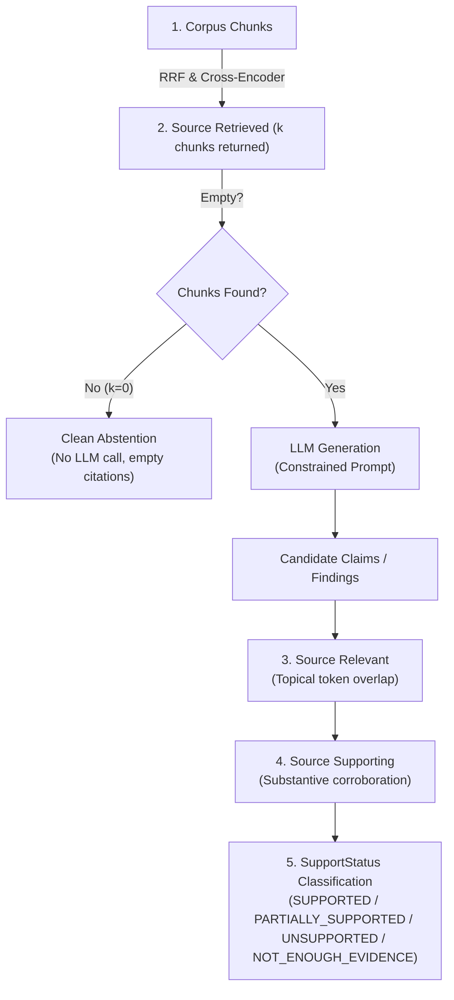

# Engineering Record: Package 4 — Evidence Integrity and Answer Generation

## 1. Executive Summary
In Phase 4, we audited evidence provenance, claim verification, and answer generation across PaperTrail ([`retrieval/evidence.py`](file:///Users/suhaas/Projects/RAGSS/retrieval/evidence.py), [`retrieval/paper_analysis.py`](file:///Users/suhaas/Projects/RAGSS/retrieval/paper_analysis.py), [`retrieval/cross_paper_analysis.py`](file:///Users/suhaas/Projects/RAGSS/retrieval/cross_paper_analysis.py), and [`retrieval/pipeline.py`](file:///Users/suhaas/Projects/RAGSS/retrieval/pipeline.py)).

Prior to this phase, the system suffered from three fundamental flaws in evidence integrity:
1. **Unverified Claims Marked `SUPPORTED` by Default**: In [`PaperAnalyzer`](file:///Users/suhaas/Projects/RAGSS/retrieval/paper_analysis.py#L123-L131), every generated claim was unconditionally labeled `SupportStatus.SUPPORTED` and attached indiscriminately to all retrieved chunks, regardless of whether the evidence actually corroborated, partially corroborated, or contradicted the claim.
2. **Missing Abstention on Empty Context**: When retrieval returned 0 documents, both [`BasicRetriever.generate()`](file:///Users/suhaas/Projects/RAGSS/retrieval/pipeline.py) and [`PaperAnalyzer.analyze_paper()`](file:///Users/suhaas/Projects/RAGSS/retrieval/paper_analysis.py) still invoked the LLM with empty or placeholder strings (`"No evidence text found for this paper."`), wasting compute and inviting ungrounded parametric hallucinations.
3. **Evidence Pollution in Cross-Paper Findings**: In [`CrossPaperAnalyzer`](file:///Users/suhaas/Projects/RAGSS/retrieval/cross_paper_analysis.py), each comparative finding attached *all* chunks from the detected papers, rather than isolating the specific chunks corroborating that specific finding.

We resolved these vulnerabilities by implementing a modular `ClaimVerifier`, safe citation conversions, per-claim and per-finding evidence filtering, and clean zero-retrieval abstention without LLM invocation.

---

## 2. The Evidence & Grounding Hierarchy

In production RAG systems, conflating retrieval with evidence verification is a primary cause of silent hallucinations. We enforce a strict five-tier distinction:



| Tier | Concept | System Meaning | Failure Mode If Conflated |
| :--- | :--- | :--- | :--- |
| **1** | **Source Retrieved** | Chunk passed vector/BM25 retrieval and reranking thresholds. | Assuming retrieval implies relevance causes noisy context in prompts. |
| **2** | **Source Relevant** | Chunk mentions topics or entities related to the query/claim. | Assuming relevance implies support causes false corroboration. |
| **3** | **Source Supporting** | Chunk contains empirical data or statements confirming the claim. | Conflating partial mention with full support creates ungrounded citations. |
| **4** | **Claim Status** | Explicit verification rating (`SUPPORTED`, `PARTIALLY_SUPPORTED`, `UNSUPPORTED`, `NOT_ENOUGH_EVIDENCE`). | Defaulting to `SUPPORTED` blindly misleads downstream researchers and users. |
| **5** | **Clean Abstention** | Immediate fallback without calling LLM when context is missing. | Invoking LLM with empty context forces parametric hallucinations. |

---

## 3. Audit Findings: Confirmed Defects vs. Speculative Risks

| Finding | Severity | Status | Concrete Evidence / Root Cause |
| :--- | :--- | :--- | :--- |
| **1. Unverified Claims Labeled `SUPPORTED`** | **Critical** | **Confirmed & Fixed** | [`paper_analysis.py:127`](file:///Users/suhaas/Projects/RAGSS/retrieval/paper_analysis.py#L127) hardcoded `support_status=SupportStatus.SUPPORTED` and `Claim` dataclass defaulted to `SUPPORTED`. Even the string `"Not available in the provided evidence."` was labeled a supported claim! |
| **2. LLM Invoked on Zero Retrieval (`pipeline.py`)** | **High** | **Confirmed & Fixed** | [`BasicRetriever.generate()`](file:///Users/suhaas/Projects/RAGSS/retrieval/pipeline.py) invoked `self.chain.invoke()` even when `results == []`, risking hallucinations and wasting inference latency. |
| **3. LLM Invoked on Missing Evidence (`paper_analysis.py`)** | **High** | **Confirmed & Fixed** | [`PaperAnalyzer.analyze_paper()`](file:///Users/suhaas/Projects/RAGSS/retrieval/paper_analysis.py) invoked `self.chain.invoke()` with `"No evidence text found for this paper."` when retrieval returned empty, instead of cleanly abstaining. |
| **4. Evidence Pollution in Cross-Paper Analysis** | **Medium** | **Confirmed & Fixed** | [`cross_paper_analysis.py:215`](file:///Users/suhaas/Projects/RAGSS/retrieval/cross_paper_analysis.py#L215) attached all source evidence chunks of every detected paper to every finding, rather than filtering to chunks relevant to the specific finding. |
| **5. Unsafe Page Metadata Conversion** | **Low** | **Confirmed & Fixed** | `int(doc.metadata.get("page", 0)) + 1` in `pipeline.py` and `paper_analysis.py` crashed on `None` or non-integer string values. |
| **6. Missing Fast Unit Tests** | **Medium** | **Confirmed & Fixed** | `test_paper_analysis.py` and `test_cross_paper_analysis.py` only contained slow integration tests requiring live LLM weights, leaving core logic untested in offline CI. |

---

## 4. Implementation Details

### A. Modular `ClaimVerifier`, Threshold Validation & Semantic Overlap ([`retrieval/evidence.py`](file:///Users/suhaas/Projects/RAGSS/retrieval/evidence.py))
- Changed `Claim.support_status` default from `SUPPORTED` to `NOT_ENOUGH_EVIDENCE`.
- Implemented `ClaimVerifier`:
  - Enforces threshold configuration validation (`0.0 <= partial_threshold <= support_threshold <= 1.0`), raising `ValueError` on invalid bounds.
  - Strips standard English stop words and punctuation to extract content tokens.
  - Computes content-token overlap ratio against candidate evidence chunks.
  - Classifies status:
    - $\text{ratio} \ge \text{support\_threshold} \implies$ `SUPPORTED` (only chunks satisfying $\text{ratio} \ge \text{support\_threshold}$ attached).
    - $\text{partial\_threshold} \le \text{ratio} < \text{support\_threshold} \implies$ `PARTIALLY_SUPPORTED` (only chunks satisfying $\text{ratio} \ge \text{partial\_threshold}$ attached).
    - $\text{ratio} < \text{partial\_threshold} \implies$ `UNSUPPORTED` (empty evidence attached).
    - $\text{len}(\text{candidate\_evidence}) == 0 \implies$ `NOT_ENOUGH_EVIDENCE` (empty evidence attached).
  - Implements a verified contract for `verifier_fn` across both `verify()` and `filter_supporting_evidence()`.
  - Exposes dependency injection into `PaperAnalyzer(verifier=...)` and `CrossPaperAnalyzer(verifier=...)`.

### B. Clean Abstention in Answer Generation ([`retrieval/pipeline.py`](file:///Users/suhaas/Projects/RAGSS/retrieval/pipeline.py))
```python
def generate(self, query: str) -> dict:
    results = self.retriever.retrieve(query)

    # Clean abstention: If no documents were retrieved, do NOT invoke the LLM.
    if not results:
        return {
            "answer": "The provided documents do not contain enough information to answer this.",
            "citations": [],
        }
    ...
```

### C. Clean Abstention & Grounded Claims in Paper Analysis ([`retrieval/paper_analysis.py`](file:///Users/suhaas/Projects/RAGSS/retrieval/paper_analysis.py))
- If `evidence_docs` is empty after both retrieval and parent fallback, immediately returns a zero-hallucination `PaperAnalysis` with `"Not available in the provided evidence."` fields, empty citations, and empty claims without calling the LLM.
- Filters out non-claim placeholder texts.
- Evaluates valid claims through `self.verifier.verify()`, linking each claim only to corroborating chunks.

### D. Per-Finding Evidence Filtering in Cross-Paper Analysis ([`retrieval/cross_paper_analysis.py`](file:///Users/suhaas/Projects/RAGSS/retrieval/cross_paper_analysis.py))
- Uses `self.verifier.filter_supporting_evidence(finding_text, paper_evidence, threshold=0.15)` to associate specific corroborating chunks to individual findings.
- Invariant enforced: If no evidence satisfies the selection rule, the finding receives an empty evidence list (`[]`), strictly preventing evidence pollution.

---

## 5. Adversarial Audit & Documented Heuristic Limitations

Token overlap is a surface lexical heuristic and **not** proof of factual truth or semantic entailment:
1. **Negation / Polarity Inversion**: A claim contradicted by evidence with nearly identical wording (e.g. *"Transformers do not use recurrent layers"*) produces a false `SUPPORTED` status under token overlap. Tested and verified in `test_adversarial_negation_limitation_documented`.
2. **Numerical Discrepancies**: Evidence reporting 62.1% vs claim asserting 95.4% shares all vocabulary words and flags false support. Tested and verified in `test_adversarial_numerical_mismatch_limitation_documented`.
3. **Named Entity Substitutions**: Template claims with swapped entities (ResNet vs Transformer) share 85%+ vocabulary. Tested and verified in `test_adversarial_entity_substitution_limitation_documented`.
4. **Vocabulary Mismatch on Paraphrases**: True semantic equivalence phrased with different vocabulary (e.g. *"quadratic complexity with sequence length"* vs *"time proportional to square of token count"*) yields near 0% overlap and results in false `UNSUPPORTED`. Tested and verified in `test_adversarial_genuine_paraphrase_limitation_documented`.

These limitations establish why surface overlap scores must **never** be presented as calibrated probabilities or guarantees against hallucination. True semantic entailment requires an injected NLI model via `verifier_fn`.

---

## 6. Verification & Regression Analysis

All offline unit tests execute deterministically in **< 3.0 seconds** without model downloads:
- **Total Tests Passing**: 79 passed offline tests.
- **Deselected Tests**: 4 slow integration tests marked `@pytest.mark.integration`.
- **Evaluation Benchmark**: 12/12 queries passing with 3/3 out-of-corpus queries cleanly abstaining (0 false positives).
