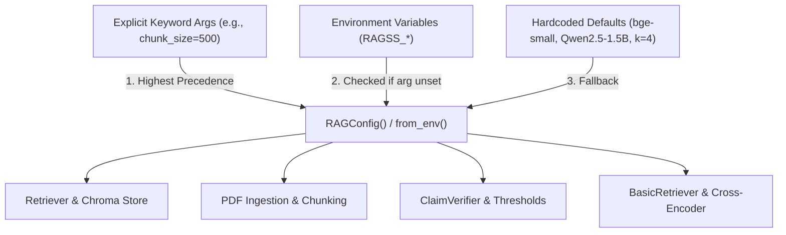

# Engineering Record: Package 5 — CLI, Pipeline Unification, and Production Readiness

## 1. Executive Summary

In Phase 5, we audited and unified the developer and operator interface across PaperTrail/RAGSS, addressing architectural debt in configuration management, command-line entry points, import side effects, error reporting, and pipeline prompt consistency.

Prior to this phase, the repository exhibited five critical production readiness anti-patterns:
1. **Entry Point Fragmentation:** Users and downstream scripts had to juggle fragmented, inconsistent entry points (`run_bank_query.py`, `python -m retrieval.paper_analysis`, `evaluation/evaluate.py`, `workflows/workflow.py`), each having differing argument conventions, error reporting, and output formats.
2. **Hardcoded Configuration Sprawl & Import-Time Evaluation:** Critical runtime settings (chunk size, chunk overlap, model checkpoints, vector store directory, retrieval constants $k$ and RRF $k=60$, evidence verification thresholds) were evaluated once at module import time with no dynamic runtime updates or invariant validation.
3. **Import-Time Side Effects:** Importing `workflows/workflow.py` immediately executed LangGraph graph compilation, attempted mermaid PNG diagram rendering via external network calls, and wrote to `stdout`.
4. **Prompt Relics & Script Rigidity:** `retrieval/pipeline.py` contained hardcoded prompt instructions referencing undergraduate coursework ("Project Guide assistant"), while `evaluation/evaluate.py` executed exclusively as a standalone script without programmatic invocation APIs.
5. **Stream Pollution on Machine-Readable Output:** Error diagnostics and informative status messages were written to `stdout`, breaking downstream JSON parsers when structured automation (`--json`) was requested.

We resolved these issues by establishing a centralized, dynamic `RAGConfig` system with invariant validation, creating a unified production CLI entry point (`main.py`), eliminating import-time side effects, refactoring the evaluation harness into a callable library with quiet mode, and writing a deterministic test suite with full error-code and stream-isolation coverage.

---

## 2. Architecture & Design Decisions

### A. Centralized Configuration Hierarchy & Validation ([`retrieval/config.py`](file:///Users/suhaas/Projects/RAGSS/retrieval/config.py))

Configuration parameters are consolidated into an immutable, frozen dataclass `RAGConfig`. Precedence follows a strict three-tier hierarchy evaluated dynamically at instantiation time:
1. **Explicit Constructor Arguments (Highest):** Overrides passed at instantiation time in Python code.
2. **Environment Variables (`RAGSS_*`):** Dynamic runtime overrides evaluated whenever `RAGConfig()` or `RAGConfig.from_env()` is called.
3. **Documented Defaults (Lowest):** Sensible defaults suitable for out-of-the-box local operation.



#### Dynamic Invariant Validation:
All configuration values undergo strict boundary validation upon initialization:
- **`chunk_size`**: Must be a positive integer (`> 0`).
- **`chunk_overlap`**: Must be non-negative (`>= 0`) and strictly less than `chunk_size`.
- **Retrieval `default_k` and `rrf_k`**: Must be positive integers (`> 0`).
- **Verification Thresholds**: Must satisfy $0.0 \le \text{partial\_threshold} \le \text{support\_threshold} \le 1.0$ and $0.0 \le \text{cross\_finding\_threshold} \le 1.0$.
- **Type Safety**: Non-numeric environment variable values (e.g., `RAGSS_CHUNK_SIZE="bad"`) raise descriptive `ValueError` exceptions immediately rather than causing cryptic failures downstream.

#### Supported Environment Variables:
| Variable | Default Value | Description |
| :--- | :--- | :--- |
| `RAGSS_EMBED_MODEL` | `BAAI/bge-small-en-v1.5` | Dense embedding model checkpoint |
| `RAGSS_CROSS_ENCODER_MODEL` | `cross-encoder/ms-marco-MiniLM-L-6-v2` | Cross-encoder reranking checkpoint |
| `RAGSS_LLM_MODEL` | `Qwen/Qwen2.5-1.5B-Instruct` | Local generation model checkpoint |
| `RAGSS_CHUNK_SIZE` | `200` | Target child chunk character length |
| `RAGSS_CHUNK_OVERLAP` | `20` | Child chunk overlap characters |
| `RAGSS_CHROMA_DIR` | `<repo_root>/chroma_db` | Persistent ChromaDB storage path |
| `RAGSS_COLLECTION_NAME` | `research_papers` | ChromaDB collection name |
| `RAGSS_RETRIEVAL_K` | `4` | Default number of passages to return |
| `RAGSS_RRF_K` | `60` | Reciprocal Rank Fusion smoothing constant |
| `RAGSS_SUPPORT_THRESHOLD` | `0.5` | Minimum token overlap for `SUPPORTED` claim |
| `RAGSS_PARTIAL_THRESHOLD` | `0.25` | Minimum token overlap for `PARTIALLY_SUPPORTED` |
| `RAGSS_CROSS_FINDING_THRESHOLD`| `0.15` | Minimum overlap for cross-paper finding evidence |

---

### B. Unified Production CLI Architecture ([`main.py`](file:///Users/suhaas/Projects/RAGSS/main.py))

We introduced `main.py` (exposed as the `ragss` command) featuring subcommands covering all application workflows:

```
ragss [-h] {query, analyze, compare, evaluate, ingest} ...
```

#### 1. `query` — Grounded Question Answering & Retrieval Preview
- **Command:** `python main.py query "What is scaled dot-product attention?" --k 4`
- **Retrieval Preview Mode (`--no-llm`):**
  - **What it avoids:** Completely skips loading and initializing the autoregressive Large Language Model (`Qwen2.5-1.5B-Instruct`), avoiding prompt template formatting and iterative token generation.
  - **What it executes:** Executes the full retrieval pipeline: dense vector embedding inference (`bge-small-en-v1.5`), BM25 sparse retrieval, Reciprocal Rank Fusion ($k=60$), cross-encoder reranking (`ms-marco-MiniLM-L-6-v2`), and parent document expansion.
  - **Performance guarantee note:** Retrieval latency depends entirely on local hardware (CPU vs. GPU/MPS), corpus scale, and warm/cold model state; no unsupported numerical latency guarantees are made.
- **Machine-Readable Output (`--json`):** Emits structured JSON containing query, answer, mode, and citations list with document IDs and 1-indexed page numbers.

#### 2. `analyze` — Single and Multi-Paper Structured Extraction
- **Command:** `python main.py analyze paper1.pdf paper2.pdf --output analysis.json --k 4`
- Extracts Title, Research Problem, Methodology, Major Claims, Empirical Evidence, Limitations, and verified `Claim` objects.
- Supports both terminal display and `--json` or `--output <path>` persistence.

#### 3. `compare` — Cross-Paper Comparative Synthesis
- **Command:** `python main.py compare paper1.pdf paper2.pdf --output cross_analysis.json`
- Synthesizes similarities, differences, corroborating findings, conflicting findings, and open research gaps across multiple indexed papers.
- Enforces strict input validation: requires $\ge 2$ documents unless `--allow-single` is explicitly passed.

#### 4. `evaluate` — Benchmark Evaluation Harness
- **Command:** `python main.py evaluate --mode fixture --k 5 --output-json results.json --json`
- Wraps the evaluation engine into the unified CLI, supporting fast offline `--mode fixture` and live corpus `--mode live`.
- Supports `--json` flag to print benchmark metrics directly to `stdout` in machine-readable format while suppressing human-readable log noise.

#### 5. `ingest` — Standalone Corpus Indexing
- **Command:** `python main.py ingest /path/to/papers/ --json`
- Indexes documents into ChromaDB and initializes BM25 structures without running immediate inference.

---

### C. Standardized Exit Codes & Stream Isolation Contract

A production CLI must behave predictably in shell pipelines, Docker containers, and CI runners. We formalized the relationship between `argparse`'s default behavior and application-level exit codes:

| Exit Code | Semantic Category | Scenario / Trigger | Responsible Layer |
| :---: | :--- | :--- | :--- |
| **0** | **Success** | Successful query execution, analysis, evaluation, or `--help` invocation. | Application / `argparse` |
| **1** | **Domain / Validation Error** | Missing file paths, non-PDF input, empty query strings, comparing $< 2$ papers without `--allow-single`, non-positive $K$, or invalid configuration values. | Application Domain Logic |
| **2** | **Syntax / System Error** | Unrecognized CLI arguments, missing required options, or unhandled runtime/database exceptions. | `argparse` Syntax Validator / Top-Level Exception Boundary |
| **130** | **Interrupted** | Process interrupted by operator via SIGINT / `KeyboardInterrupt` (`128 + 2`). | Top-Level Signal Boundary |

#### Stream Isolation Guarantee for `--json`:
When `--json` is specified:
1. **`sys.stderr`**: Strictly receives all human-readable diagnostics, warning messages, progress bars, and error descriptions.
2. **`sys.stdout`**: Strictly reserved for valid, parseable JSON payloads. In success cases, it contains the command's result payload; in error cases, it contains a structured JSON error object:
   ```json
   {
     "status": "error",
     "error": "Path does not exist: /path/to/missing.pdf",
     "exit_code": 1
   }
   ```
This ensures downstream pipeline consumers (such as `jq` or `subprocess.check_output`) never encounter `JSONDecodeError` caused by unexpected console logs or error strings.

---

### D. Elimination of Import-Time Side Effects ([`workflows/workflow.py`](file:///Users/suhaas/Projects/RAGSS/workflows/workflow.py))

Previously, simply running `import workflows.workflow` triggered:
```python
# PREVIOUS DANGEROUS PATTERN:
try:
    with open("rag_graph.png", "wb") as f:
        f.write(app.get_graph().draw_mermaid_png())
    print("Graph saved as rag_graph.png")
except Exception as e:
    print(f"Could not save graph as image: {e}")
```
This caused:
1. Unwanted PNG file creation in the working directory on every test run.
2. HTTP requests to external mermaid rendering services.
3. Unsolicited console output breaking `--json` stdout pipes.

We refactored this into an explicit, callable function `export_workflow_diagram(output_path)` guarded by `if __name__ == "__main__":`.

---

### E. Pipeline Prompt Modernization ([`retrieval/pipeline.py`](file:///Users/suhaas/Projects/RAGSS/retrieval/pipeline.py))

The system prompt was purged of undergraduate coursework references:
- **Before:** `"You are a Project Guide assistant. Help students and reviewers understand the project based only on the provided context."`
- **After:** `"You are an expert research and technical document evidence assistant. Answer the user question based strictly and exclusively on the provided context passages."`

---

## 3. Test Coverage & Verification

Phase 5 added 31 dedicated unit tests across [`tests/test_config.py`](file:///Users/suhaas/Projects/RAGSS/tests/test_config.py) (8 tests) and [`tests/test_cli.py`](file:///Users/suhaas/Projects/RAGSS/tests/test_cli.py) (23 tests), bringing the total test suite to **110 passing offline tests**:

```
============================= test session starts ==============================
platform darwin -- Python 3.13.12, pytest-9.1.1, pluggy-1.6.0
rootdir: /Users/suhaas/Projects/RAGSS, configfile: pytest.ini
collected 114 items / 4 deselected / 110 selected

tests/test_chunking.py .......                                           [  6%]
tests/test_cli.py .......................                                [ 27%]
tests/test_config.py ........                                            [ 34%]
tests/test_cross_paper_analysis.py ...                                   [ 37%]
tests/test_embeddingss.py ..                                             [ 39%]
tests/test_eval_harness.py .......                                       [ 45%]
tests/test_evidence_provenance.py ................                       [ 60%]
tests/test_hybrid_retrieval.py ........                                  [ 67%]
tests/test_metrics.py .......................                            [ 88%]
tests/test_paper_analysis.py ....                                        [ 91%]
tests/test_parent_child.py ......                                        [ 97%]
tests/test_pipeline.py ...                                               [100%]

================ 110 passed, 4 deselected, 6 warnings in 2.81s =================
```

### Verified Behaviors:
1. **Parser Construction & Help:** Verified all 5 subcommands; `--help` exits with code `0`.
2. **Argparse Syntax Error (Code 2):** Unrecognized CLI arguments return exit code `2` with stderr diagnostics.
3. **Empty Query Detection (Code 1):** Whitespace/empty query returns code `1` and emits clean JSON when `--json` is passed.
4. **Non-Existent File Detection (Code 1):** Missing paths return code `1` with clean JSON on `--json`.
5. **Non-PDF Rejection (Code 1):** Passing a `.txt` file returns code `1` with descriptive error.
6. **Compare Paper Threshold (Code 1):** Comparing 1 paper without `--allow-single` returns code `1`.
7. **Negative $K$ Validation (Code 1):** Passing `--k 0` or negative integers returns code `1`.
8. **Retrieval Preview (`--no-llm`):** Verified retriever execution while asserting `BasicRetriever` generation chain is never initialized.
9. **JSON Parseability on Errors:** Verified that in all error scenarios with `--json`, `stdout` remains valid JSON parsable by `json.loads()`.
10. **Signal Handling (Code 130):** Keyboard interrupt cleanly returns code `130` with cancellation JSON on `--json`.
11. **Internal Error Boundary (Code 2):** Uncaught exceptions return code `2` with `status: internal_error` JSON on `--json`.
12. **Config Dynamic Reading & Precedence:** Explicit constructor arg $>$ environment variable $>$ default fallback.
13. **Config Validation Invariants:** Invalid bounds on chunk sizes, overlaps, $K$, and thresholds raise descriptive `ValueError`s.
