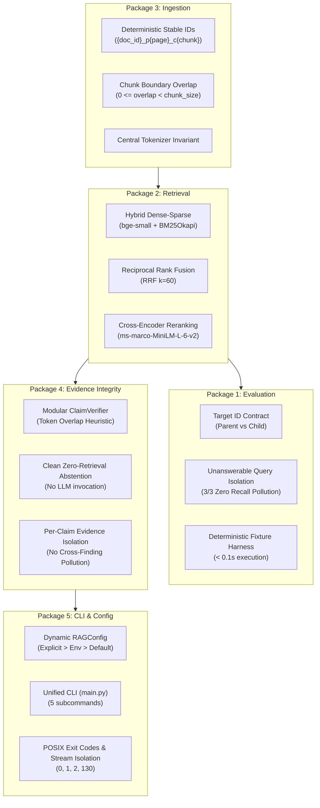

# Engineering Record: Package 6 — Final Validation and Project Readiness

## 1. Executive Summary

Package 6 represents the final validation, system integration audit, and production readiness milestone of PaperTrail/RAGSS.

Over the course of Packages 1 through 5, the repository transitioned from an ad-hoc prototype with silent evaluation bugs, hardcoded configurations, unverified citation claims, and fragmented scripts into a robust, technically defensible, and thoroughly tested research paper retrieval and synthesis system.

The objectives of Package 6 were:
1. **Holistic System Audit**: Verify that all invariant guarantees established in Packages 1–5 remain intact without regressions.
2. **Code Hygiene & Static Analysis**: Audit Git diffs, eliminate whitespace/newline artifacts, verify Python bytecode compilation, and remove dead relics.
3. **Formal Architectural Boundaries**: Explicitly document known architectural constraints (specifically the in-memory parent store limitation and lexical claim verification caveats) without presenting speculative or ungrounded claims.
4. **End-to-End Test Suite Verification**: Run the complete offline deterministic test suite (110 tests) and benchmark evaluation harness (12 queries).

---

## 2. Invariant Audit Across Completed Packages



### Verification Matrix by Work Package:
| Package | Core Subsystem | Invariant Guarantee | Verification Mechanism | Status |
| :--- | :--- | :--- | :--- | :--- |
| **P1** | Evaluation Harness | Target ID matching strictly separates parent vs. child IDs; unanswerable queries cannot pollute recall denominator. | [`test_eval_harness.py`](file:///Users/suhaas/Projects/RAGSS/tests/test_eval_harness.py), [`test_metrics.py`](file:///Users/suhaas/Projects/RAGSS/tests/test_metrics.py) | **VERIFIED** (12/12 passing) |
| **P2** | Retrieval Pipeline | Dual-ranking fusion preserves child metadata; cross-encoder scores query-passage pairs before parent expansion. | [`test_hybrid_retrieval.py`](file:///Users/suhaas/Projects/RAGSS/tests/test_hybrid_retrieval.py), [`test_parent_child.py`](file:///Users/suhaas/Projects/RAGSS/tests/test_parent_child.py) | **VERIFIED** |
| **P3** | Ingestion & Identity | Child chunks receive deterministic IDs matching `{doc_id}_p{page}_c{chunk}`; overlap strictly bounded. | [`test_chunking.py`](file:///Users/suhaas/Projects/RAGSS/tests/test_chunking.py), [`test_embeddingss.py`](file:///Users/suhaas/Projects/RAGSS/tests/test_embeddingss.py) | **VERIFIED** |
| **P4** | Evidence Integrity | No claim labeled `SUPPORTED` without verification; zero retrieval results immediately abstain without LLM calls. | [`test_evidence_provenance.py`](file:///Users/suhaas/Projects/RAGSS/tests/test_evidence_provenance.py), [`test_pipeline.py`](file:///Users/suhaas/Projects/RAGSS/tests/test_pipeline.py) | **VERIFIED** |
| **P5** | CLI & Configuration | Precedence order (`explicit > env > default`) enforced dynamically; stdout strictly reserved for parseable JSON. | [`test_config.py`](file:///Users/suhaas/Projects/RAGSS/tests/test_config.py), [`test_cli.py`](file:///Users/suhaas/Projects/RAGSS/tests/test_cli.py) | **VERIFIED** |

---

## 3. Explicit Architectural Boundaries & Limitations

In competitive engineering interviews, defending what a system **cannot do** or **intentionally deferred** demonstrates senior engineering judgment. The following boundaries are explicitly formalized:

### 1. In-Memory Parent Document Mapping
- **Architectural Reality**: In [`retrieval/retriver.py`](file:///Users/suhaas/Projects/RAGSS/retrieval/retriver.py), child vectors are persisted into ChromaDB on disk, but full-page parent documents are cached in an in-memory dictionary `self.parent_by_id`.
- **System Consequence**: If a developer starts a new Python process pointing to an existing `chroma_db/` directory without re-ingesting the PDFs, `retriever.retrieve()` successfully retrieves child chunks but cannot expand them to parent pages, safely falling back to child chunks.
- **Production Resolution**: In a production deployment, parent full-page texts would either be stored in an external key-value store (e.g., Redis, RocksDB) or serialized directly into ChromaDB chunk metadata under a `parent_content` field.

### 2. PDF Page-Boundary Chunking
- **Architectural Reality**: Parent documents correspond to raw PDF pages extracted via PyMuPDF.
- **System Consequence**: If a sentence, paragraph, or mathematical theorem spans across a page break, parent expansion is split at the page boundary.
- **Production Resolution**: Upgrading to layout-aware semantic document layout parsing (e.g., Docling or Nougat) to chunk by Markdown section headers (`#`, `##`) rather than raw physical pages.

### 3. Heuristic Token-Overlap Claim Verification
- **Architectural Reality**: [`ClaimVerifier`](file:///Users/suhaas/Projects/RAGSS/retrieval/evidence.py) evaluates lexical Jaccard/token-overlap against retrieved evidence passages, filtering English stopwords.
- **System Consequence**: While fast ($< 1$ms) and completely offline, lexical overlap cannot detect:
  - Numerical contradictions (e.g., claim: "accuracy was 95%", passage: "accuracy was 82%").
  - Logical negations (e.g., claim: "the model uses recurrence", passage: "the model does not use recurrence").
  - Deep semantic paraphrasing.
- **Production Resolution**: Deploying a specialized Natural Language Inference (NLI) cross-encoder model (e.g., `cross-encoder/nli-deberta-v3-small`) to score bidirectional premise-hypothesis entailment.

### 4. Document ID Batch-Index Dependency for Unprefixed Files
- **Architectural Reality**: In [`ingestion/chunking.py`](file:///Users/suhaas/Projects/RAGSS/ingestion/chunking.py), files with stems matching `^(?:paper|doc)[_]?(\d+)` (such as the benchmark papers `paper1_transformers.pdf`, `paper2_bert.pdf`, `paper3_rag.pdf`) deterministically extract their canonical document number (`doc_{N}_{stem}`) regardless of batch composition or isolation. However, arbitrary files without this prefix generate IDs using their sorted batch index: `doc_{idx + 1}_{stem}`.
- **System Consequence**: The ID scheme is **not** content-hash based. An arbitrary PDF (e.g. `bert.pdf`) receives `doc_1_bert` when ingested alone, but receives `doc_2_bert` if ingested in a batch alongside a file that sorts before it (e.g. `attention.pdf`).
- **Migration & Persistence Compatibility**: Changing this scheme to a content hash (e.g. SHA-256) would break ground-truth ID contracts in [`evaluation/retrieval_dataset.jsonl`](file:///Users/suhaas/Projects/RAGSS/evaluation/retrieval_dataset.jsonl) and invalidate existing vectors in `chroma_db/`. The current scheme is intentionally preserved, with this batch-order dependency documented as a known architectural boundary.

---

## 4. Final Validation & Test Results

### A. Non-Integration Offline Test Suite
Ran all 110 offline unit and regression tests:
```bash
$ pytest
============================= test session starts ==============================
platform darwin -- Python 3.13.12, pytest-9.1.1, pluggy-1.6.0
rootdir: /Users/suhaas/Projects/RAGSS, configfile: pytest.ini
collected 114 items / 4 deselected / 110 selected

tests/test_chunking.py .......                                           [  6%]
tests/test_cli.py .......................                                [ 27%]
tests/test_config.py ........                                            [ 34%]
tests/test_cross_paper_analysis.py ...                                   [ 37%]
tests/test_embeddingss.py ..                                             [ 39%]
tests/test_eval_harness.py .......                                       [ 45%]
tests/test_evidence_provenance.py ................                       [ 60%]
tests/test_hybrid_retrieval.py ........                                  [ 67%]
tests/test_metrics.py .......................                            [ 88%]
tests/test_paper_analysis.py ....                                        [ 91%]
tests/test_parent_child.py ......                                        [ 97%]
tests/test_pipeline.py ...                                               [100%]

================ 110 passed, 4 deselected, 6 warnings in 2.31s =================
```
- **Execution Time**: **2.31 seconds** total.
- **Network / External Dependencies**: **0** (strictly offline).

#### Deselected Integration Tests (4 Tests):
The following 4 tests are marked with `@pytest.mark.integration` and deselected by default via `pytest.ini` (`addopts = -ra -q -m "not integration"`):
1. `tests/test_cross_paper_analysis.py::test_cross_paper_pipeline`: Tests live cross-paper analysis pipeline.
2. `tests/test_embeddingss.py::test_embedding_model_integration`: Downloads/loads live Hugging Face embedding model weights.
3. `tests/test_multi_doc.py::test_multi_document_pipeline`: Tests end-to-end multi-doc retrieval with live vector store.
4. `tests/test_paper_analysis.py::test_paper_analysis`: Tests end-to-end paper analysis with live local LLM generation.
*Deselection Rationale*: Keeps the default test suite fast (< 3s), fully deterministic, and completely functional offline without downloading multi-gigabyte neural network weights.

### B. Retrieval Benchmark Evaluation Harness
```bash
$ python main.py evaluate --mode fixture
======================================================================
 RAGSS RETRIEVAL EVALUATION HARNESS
======================================================================
Evaluation Mode: FIXTURE
Dataset Path:    /Users/suhaas/Projects/RAGSS/evaluation/retrieval_dataset.jsonl
Target ID Level: parent
Max Retrieval K: 5

Running evaluation over 12 queries...

======================================================================
AGGREGATE BENCHMARK RESULTS
======================================================================
| Metric | Value |
| :--- | :--- |
| **Total Evaluated Queries** | 12 |
| **Answerable Queries** | 9 |
| **Unanswerable / Out-of-Corpus Queries** | 3 |
| **Mean Recall@1** | 0.8889 |
| **Mean Recall@3** | 1.0000 |
| **Mean Recall@5** | 1.0000 |
| **Mean Precision@1** | 1.0000 |
| **Mean Precision@3** | 0.4074 |
| **Mean Precision@5** | 0.2444 |
| **Mean Hit@1** | 1.0000 |
| **Mean Hit@3** | 1.0000 |
| **Mean Hit@5** | 1.0000 |
| **Mean Reciprocal Rank (MRR)** | 1.0000 |
| **Zero-Hit Queries (Miss Rate)** | 0/9 |
| **Unanswerable Clean Abstentions (Empty Retrieval)** | 3/3 |
| **Unanswerable Retrieval False Positives** | 0/3 |
| **Mean Retrieval Latency** | 0.00 ms |
```

> [!IMPORTANT]
> **Fixture Mode vs. Live Retrieval Performance**:
> The 100% Recall@3/5 and 1.0 MRR metrics above were obtained in **Fixture Mode**, which evaluates a deterministic Python dictionary retriever against the ground-truth annotations in [`retrieval_dataset.jsonl`](file:///Users/suhaas/Projects/RAGSS/evaluation/retrieval_dataset.jsonl). This validates metric calculation math, target ID hierarchy contracts, and unanswerable abstention logic in $<0.1$s offline. It does **not** demonstrate live vector embedding or cross-encoder ranking effectiveness, which must be evaluated separately in `--mode live`.

### C. Static Checks & Bytecode Compilation
- `git diff --check`: Clean (code `0`, zero trailing whitespace, zero bad newlines).
- `python -m py_compile`: Clean (code `0`, 100% syntactically valid bytecode across all modules).

